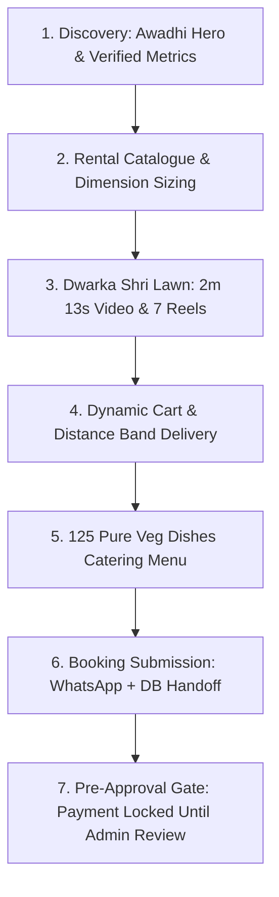
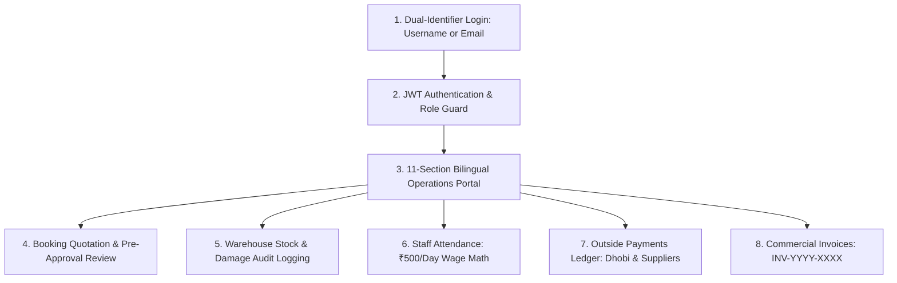

# Full-Stack Technical Walkthrough: Kandhari Tent House & Dwarka Shri Lawn

**Live Application:** [https://kandharitent.vercel.app/](https://kandharitent.vercel.app/)  
**Role:** Senior Full-Stack Engineer, UX Designer & Systems Architect  
**Domain:** Event Management E-Commerce, Mathematical Rental Pricing & Venue Operations  
**Location:** Kanpur Road, Opp. Pillar No. 37, Daroga Kheda, Lucknow, Uttar Pradesh  

---

## Executive Summary

Traditional event rentals and wedding venue operations in India operate almost entirely through offline paper records, unstandardized pricing heuristics, and verbal agreements. This creates high operational friction: lost customer inquiries during peak wedding season, disputes over tent area and delivery cartage, unaccounted warehouse damage, and chaotic cash disbursements for casual labour and dry cleaners.

This project delivers a unified, production-grade operating platform engineered to solve both sides of the transaction:
1. **The Customer Experience:** A culturally grounded Awadhi wedding storefront with an interactive rental catalogue, an authoritative server-side area and distance calculation engine, a 125-dish pure vegetarian catering showcase, and authentic media (raw 2m 13s venue video tour + 7 pre-cut vertical reels).
2. **The Business Operations Portal:** A mother-friendly bilingual (Hindi-English) 11-section unified administration dashboard providing real-time stock audits, damage logging, one-click staff attendance with ₹500/day wage calculation, an outside supplier ledger, auto-incrementing commercial billing (`INV-YYYY-XXXX`), and an autonomous Master AI agent with 3-layer persistent memory.

---

# SECTION A: Customer User Journey

The customer journey is designed around **transparency, spatial confidence, and zero hidden costs**.



### Step 1: Digital Discovery & Lucknow Venue Credibility
- **Interface:** Homepage Hero (`/`)
- **Visual Asset:** `screenshots/01_homepage_hero.png` | Annotated: `annotated/customer_step1_discovery_hero.png`
- **The Problem:** Customers looking for wedding venues in Lucknow struggle to verify physical scale and credibility online, often relying on outdated social media posts.
- **Engineering Implementation:**
  - Displays verified physical credentials upfront (*Kanpur Road, Opp. Pillar No. 37, Daroga Kheda, Lucknow*).
  - Highlights essential venue metrics prominently: **25,000 sq.ft grounds**, **1,000+ guest capacity**, **7+ AC luxury rooms**.
  - Dual call-to-actions: Direct WhatsApp inquiry button + interactive rental cart.

### Step 2: Standardized Rental Catalogue & Dimension Sizing
- **Interface:** Rental Catalogue (`/items`)
- **Visual Asset:** `screenshots/03_rental_catalogue.png` | Annotated: `annotated/customer_step2_catalogue_selection.png`
- **The Problem:** Local rental shops quote arbitrary rates based on customer appearance, creating mistrust.
- **Engineering Implementation:**
  - 19+ standardized items with clear rates: PVC Chair (₹15), Velvet Chair with cover (₹45), Round Table (₹200), Jumbo Desert Cooler (₹1,500).
  - Category filter pills (Chairs, Tables, Tents, Stages, Coolers) with instant responsive filtering.
  - Dimension-based inputs for customizable items (Normal Shamiana ₹5/sq.ft, Waterproof German Hangar ₹30/sq.ft).

### Step 3: Mathematical Pricing Engine & Distance Band Delivery
- **Interface:** Interactive Enquiry Cart
- **Visual Asset:** `screenshots/05_enquiry_cart_and_pricing.png` | Annotated: `annotated/customer_step3_cart_pricing_breakdown.png`
- **The Problem:** Post-event disputes regarding rental duration and transport/labour charges.
- **Engineering Implementation:**
  - Authoritative calculation formula:
    $$\text{Line Total} = (\text{Length} \times \text{Width}) \times \text{Rate per sq.ft} \times \text{Rental Days} \times \text{Quantity}$$
  - Inclusive calendar day counting (e.g. Dec 10 to Dec 11 = 2 calendar rental days).
  - 3 standardized distance delivery bands:
    - **Band 1 (0–3 km):** Cartage ₹500 | Labour ₹500 base
    - **Band 2 (3–7 km):** Cartage ₹1,000 | Labour ₹1,000 base
    - **Band 3 (> 7 km):** Cartage ₹1,500 base + ₹75/km (marked provisional for admin review)

### Step 4: Dwarka Shri Lawn Video Tour & 7 Reels
- **Interface:** Dedicated Venue Showcase (`/lawn`)
- **Visual Asset:** `screenshots/06_dwarka_shri_lawn_showcase.png` | Annotated: `annotated/customer_step4_venue_reels_exploration.png`
- **The Problem:** Heavy 3D canvas animations caused high mobile latency (slow LCP) and failed to convey real ground conditions.
- **Engineering Implementation:**
  - Completely replaced Three.js canvas with an authentic 2m 13s WhatsApp video player, reducing transformed bundle modules by 601 modules.
  - 6 visual venue area tabs: Grand Entrance, Main Lawn, Halwai Kitchen, AC Hall, Stage, and Guest Rooms.
  - 7 pre-cut vertical 9:16 reels with modal video player, direct MP4 download, and one-click WhatsApp share.

### Step 5: Catering Menu & Booking Submission
- **Interface:** Catering Menu (`/catering`) & Enquiry Form (`/contact`)
- **Visual Asset:** `screenshots/08_catering_menu.png` | Annotated: `annotated/customer_step5_catering_and_enquiry.png`
- **The Problem:** Wedding hosts need custom food counter selections with clear per-plate packages before committing.
- **Engineering Implementation:**
  - 125 pure vegetarian dishes across 17 categories (Awadhi Chaat, Live Tandoor, Shahi Curries, Live Halwa, Mithai).
  - 8 curated packages (Silver, Gold, Diamond, Royal Vivah) with dynamic per-plate math.
  - Dual-channel submission: Persists to backend database while generating a pre-formatted WhatsApp quote payload to `+91 1800-890-3456`.

---

# SECTION B: Business Operations & Admin Flow

The admin system is engineered for **non-technical family business operators**, ensuring intuitive oversight without sacrificing backend security.



### Step 1: Secure Dual-Identifier Authentication
- **Interface:** Administrator Login (`/admin/login`)
- **Visual Asset:** `screenshots/10_admin_login_portal.png` | Annotated: `annotated/admin_step1_auth_guard.png`
- **Security Features:**
  - Supports dual identifiers: Username (`admin`) or verified owner email (`varunkandhari612@gmail.com`).
  - Passwords cryptographically hashed using **bcrypt** (10 salt rounds).
  - Local CLI recovery tool (`node server/scripts/resetAdmin.js [newPassword]`) enables the authorized owner to reset passwords securely without exposing secrets.
  - JWT tokens issued with 24-hour expiration and `role: "admin"` claim.

### Step 2: 11-Section Operations Command Center
- **Interface:** Unified Admin Dashboard (`/admin/dashboard`)
- **Visual Asset:** `screenshots/11_admin_dashboard_overview.png` | Annotated: `annotated/admin_step2_dashboard_kpis.png`
- **Design Decisions:**
  - Bilingual Hindi-English labels optimized for non-technical family operators.
  - High-contrast visual KPI cards: Total Revenue, Active Bookings, Today's Staff on Duty, Pending Outside Payments.
  - Single-page reactive workspace switching with zero reload latency.

### Step 3: Booking Lifecycle & Quotation Pre-Approval
- **Interface:** Bookings & Orders Pipeline
- **Visual Asset:** `screenshots/15_admin_bookings_pipeline.png` | Annotated: `annotated/admin_step3_booking_pipeline.png`
- **Workflow Protection:**
  - State pipeline: `New` ➔ `In Discussion` ➔ `Approved — Awaiting Payment` ➔ `Confirmed`.
  - Admin inspects date availability and warehouse stock before approving quotation.
  - Quotation revision tool allows applying custom festive discounts and manual adjustments.
  - One-click CSV ledger export for offline accounting.

### Step 4: Warehouse Inventory & Damage Audit
- **Interface:** Warehouse Stock Management
- **Visual Asset:** `screenshots/16_admin_inventory_stock.png` | Annotated: `annotated/admin_step4_inventory_damage_audit.png`
- **Audit Trail:**
  - Real-time stock audit for 19 standardized items (Total, Rented, Available).
  - Damage adjustment modal tracking broken chairs, torn canvas, and loss reasons post-event.
  - Tamper-evident audit log recording timestamp, quantity change, and admin user.

### Step 5: Staff Attendance & Outside Payments Ledger
- **Interface:** Staff Roster (`/staff`) & Outside Ledger (`/payments`)
- **Visual Asset:** `screenshots/12_admin_staff_and_attendance.png` | Annotated: `annotated/admin_step5_staff_wages_ledger.png`
- **Financial Controls:**
  - One-click daily attendance marking: **Present (₹500)**, **Half-day (₹250)**, **Absent (₹0)**.
  - Automatic calculation of daily wage liabilities across active staff roster.
  - Separate ledger for outside suppliers: **Dhobi (लॉन्ड्री / धुलाई)**, **Bamboo & Tent Suppliers**, and **Outside Transport Drivers**.

### Step 6: Commercial Bills & Marketing Reels Studio
- **Interface:** Bills & Invoices & Marketing Studio
- **Visual Asset:** `screenshots/20_admin_bills_and_invoices.png` | Annotated: `annotated/admin_step6_invoicing_and_reels.png`
- **Commercial Features:**
  - Auto-incrementing sequential numbering: `INV-2026-0001`, `INV-2026-0002`.
  - Printable official letterhead layout with complete business credentials and itemization.
  - Marketing Studio tab for previewing, updating captions, and sharing 7 vertical Dwarka Shri Lawn reels.

---

# SECTION C: Full-Stack System Architecture

```mermaid
flowchart TD
    subgraph Client Layer [React 18 + Vite 5 SPA]
        A1[Customer Storefront]
        A2[Rental Cart & Area Sizer]
        A3[Lawn Video & 7 Reels]
        A4[11-Section Bilingual Admin Dashboard]
    end

    subgraph API Routing Layer [Express 4 + Dual-Mount Router]
        B1[Dual-Mount Engine: /api/* and /*]
        B2[JWT Authentication Middleware]
        B3[Role-Based Authorization Guards]
        B4[Vercel Serverless Function Dispatcher]
    end

    subgraph Business Logic Engines [Server Services]
        C1[pricingEngine.js: Area Math & Distance Bands]
        C2[Pre-Approval Booking Workflow Engine]
        C3[Payroll & Wage Engine: ₹500/day]
        C4[Razorpay Cryptographic Signature Verifier]
    end

    subgraph Data & Persistence Layer [Dual-Mode Resilience]
        D1[(Primary: MongoDB Atlas with Mongoose)]
        D2[(Fallback: localStore.json Resilient Store)]
        D3[Media Pipeline: Fluent-FFmpeg & Static Video Engine]
    end

    Client Layer -->|HTTPS Requests| API Routing Layer
    API Routing Layer -->|Validated Calls| Business Logic Engines
    Business Logic Engines -->|CRUD Operations| Data & Persistence Layer
```

### 1. Dual-Mount Routing Engine
To resolve Vercel serverless prefix-stripping routing issues, all backend endpoints are dual-mounted:
```javascript
const mountDualRoute = (prefix, router) => {
  app.use(`/api${prefix}`, router);
  app.use(prefix, router);
};
```
This guarantees that API requests succeed regardless of whether reverse proxies forward paths with or without the `/api` prefix.

### 2. Dual-Mode Resilient Persistence
The application operates seamlessly in two environments:
- **Production Mode:** Connects to cloud **MongoDB Atlas** with Mongoose schemas (`AdminUser`, `User`, `Item`, `Enquiry`, `Venue`, `Conversation`).
- **Resilient Fallback Mode (`localStore.json`):** If a local or staging environment lacks MongoDB, the backend transparently falls back to an atomic JSON data store. All CRUD operations, inventory audits, and booking workflows remain 100% operational with zero setup friction.

### 3. Port Safety Guarantee
Ports **3000** and **5000** were strictly preserved for external developer projects. The application defaults to:
- Backend Express Server: **Port 5050** (`process.env.PORT || 5050`)
- Frontend Vite Dev Server: **Port 3050** (`client/vite.config.js`)

---

## Verification & Test Results

The platform is validated by a 23-test automated verification suite (`node server/testServer.js`) running against an isolated dynamic test port:

| Test Area | Description | Verified Result |
|---|---|---|
| **Test 1** | Health Endpoint & Resilient DB Mode | **Passed (HTTP 200)** |
| **Test 2** | Standardized Equipment Catalogue (19 items) | **Passed (HTTP 200)** |
| **Test 3** | Gallery 7 Visual Sections Verification | **Passed (146 photos verified)** |
| **Test 3.1** | Authentic Catering Menu (125 dishes across 17 categories) | **Passed (HTTP 200)** |
| **Test 4** | Dwarka Shri Lawn Details & Amenities | **Passed (HTTP 200)** |
| **Test 5** | Customer Registration & Privilege Escalation Prevention | **Passed (Role: customer)** |
| **Test 6** | Identity Spoofing Prevention | **Passed (customerId: null)** |
| **Test 7** | Critical Customer Journey (Chat -> Register -> Submit) | **Passed (HTTP 201)** |
| **Test 8** | Customer Data Isolation & Route Protection | **Passed (HTTP 403 on intruder)** |
| **Test 9** | Admin Auth, Status Pipeline & CSV Export | **Passed (HTTP 200)** |
| **Test 11** | Production 404 & Dual-Mount Routing Verification | **Passed (HTTP 200 / 404 JSON)** |
| **Test 12** | Admin Pre-Approval Workflow & Razorpay Verification | **Passed (6-step lifecycle verified)** |
| **Test 13** | Warehouse Inventory Stock & Damage Audit Logs | **Passed (Damaged qty tracked)** |
| **Test 14** | Staff Roster, Attendance & ₹500 Daily Wage Calculation | **Passed (₹500 / ₹250 wage math)** |
| **Test 15** | Master AI Agent Voice Query & Write Confirmation Gate | **Passed (Safety confirmed)** |
| **Test 16** | First-Party Privacy-Conscious Visitor Analytics | **Passed (Admin excluded)** |
| **Test 17** | Outside Payments Ledger (Dhobi & Supplier Accounting) | **Passed (HTTP 201)** |
| **Test 18** | Commercial Invoices & Billing (`INV-YYYY-XXXX`) | **Passed (HTTP 201)** |
| **Test 19** | Master Agent 3-Layer Persistent Memory | **Passed (Layers A, B, C verified)** |
| **Test 20** | Marketing Studio & Real FFmpeg Video Reel Synthesis | **Passed (9:16 MP4 rendered)** |
| **Test 21** | Secure Admin Recovery & Dual-Identifier Authentication | **Passed (Username & Email verified)** |
| **Test 22** | Dwarka Shri Lawn Reels & Raw Source Video Tour | **Passed (All 7 reels verified)** |
| **Test 23** | Area Pricing Math & Distance Band Cartage Rules | **Passed (Exact mathematical match)** |